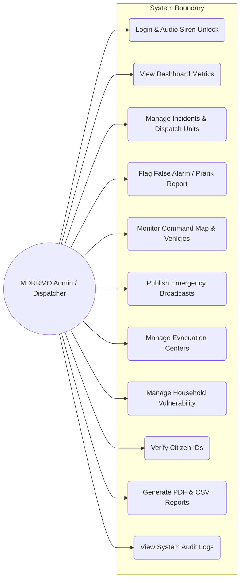
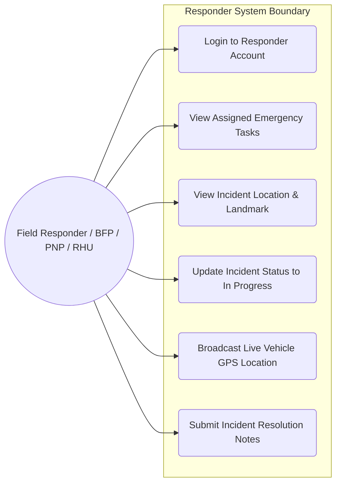
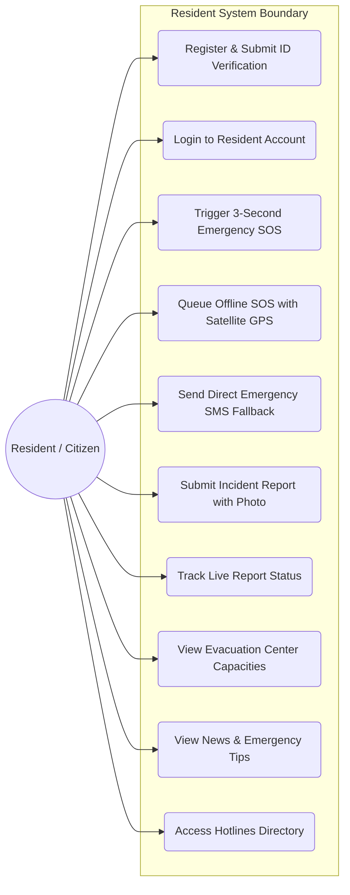
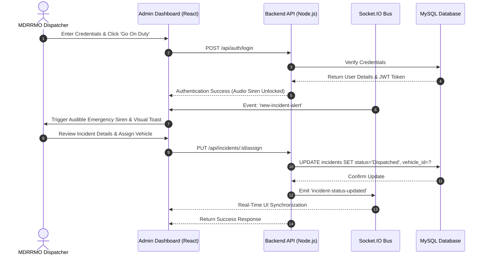
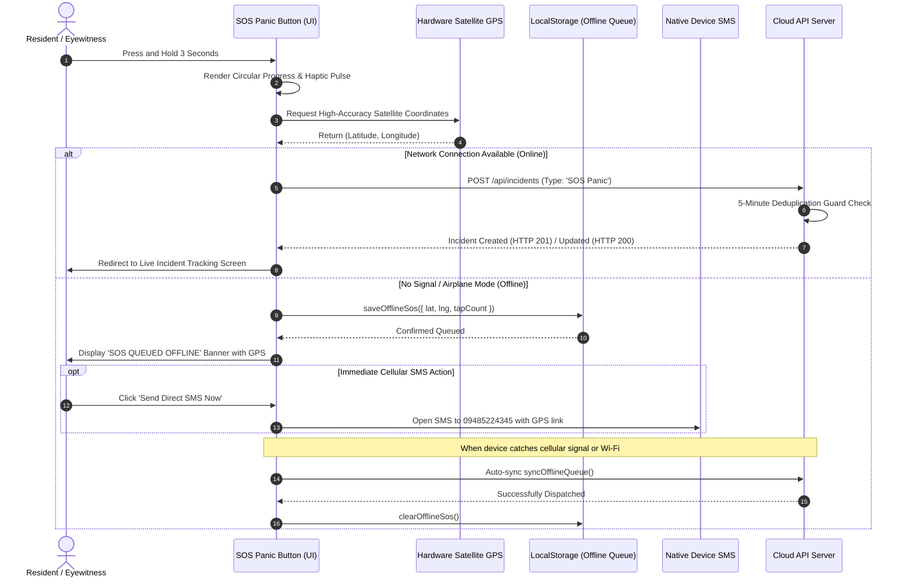
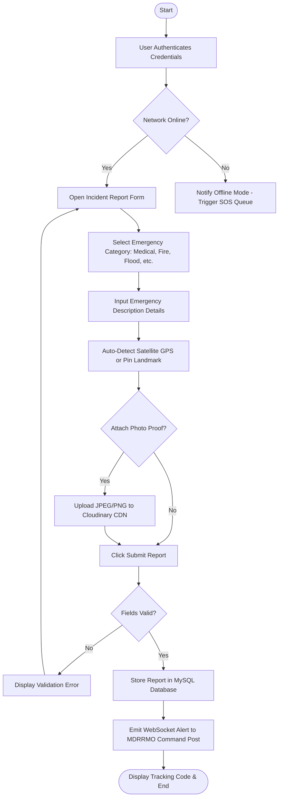
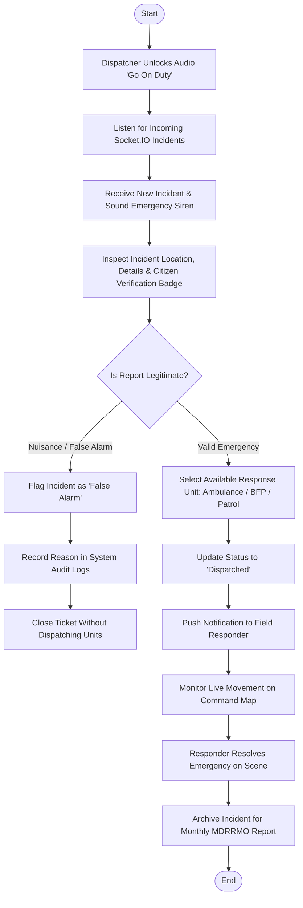

# CHAPTER IV

## JAMINDAN EMERGENCY RESPONSE COMMUNITY PLATFORM: A WEB AND MOBILE-BASED DISASTER MANAGEMENT AND REAL-TIME INCIDENT REPORTING SYSTEM

---

### System Overview

The **Jamindan Emergency Response Community Platform** was conceptualized and developed as an innovative, real-time incident reporting and dynamic disaster management system tailored specifically to the geographical and operational needs of the **Municipality of Jamindan, Capiz**. Bearing the title *"Jamindan Emergency Response Community Platform: A Web and Mobile-Based Disaster Management and Real-Time Incident Reporting System,"* the study takes a proactive and technological step toward fortifying the municipality's disaster preparedness, communication resilience, and emergency responsiveness across all its 30 rural and urban barangays.

The primary goal of the Jamindan emergency platform is to establish an immediate, bidirectional communication and dispatch bridge between residents, barangay officials, and local emergency response agencies—headed by the **Municipal Disaster Risk Reduction and Management Office (MDRRMO)**, the **Bureau of Fire Protection (BFP)**, the **Philippine National Police (PNP)**, and the **Rural Health Unit (RHU)**.

Recognizing that the Municipality of Jamindan encompasses mountainous terrains, dense river systems prone to seasonal flash flooding (such as the Panay River tributaries), and remote agricultural barangays with intermittent or nonexistent cellular reception (including Agtambi, Jaena Norte, San Jose, and Lucero), the system introduces an **offline-first architecture**. Residents in signal dead zones can trigger emergency alerts and lock satellite GPS coordinates using their mobile device's built-in satellite receiver without active internet. The alert is saved locally in an anti-spam single-ticket queue, auto-transmits the moment signal is restored, and provides an instant one-tap emergency SMS fallback to the MDRRMO Hotline (`09485224345`).

Furthermore, the system equips municipal dispatchers with an interactive, real-time **Command Map** featuring live responder vehicle tracking, dynamic geofenced evacuation center capacity monitoring, and household vulnerability profiling (tracking seniors, PWDs, infants, and pregnant mothers). By transforming incoming civilian incident reports and panic alarms into actionable spatial intelligence, the platform facilitates agile decision-making, optimal resource allocation, rapid response times, and automated monthly/annual disaster reporting for local government compliance.

---

### System Objectives

1. **Instant SOS Panic Button and Offline-First Emergency Queue Module:** To provide residents with a 3-second hold emergency panic trigger that directly locks hardware satellite GPS coordinates even without internet access, incorporates client and server-side anti-spam deduplication to prevent panic spamming, auto-transmits upon reconnection, and provides an instant one-tap SMS emergency fallback.
2. **Multimedia Incident Reporting and Verification Module:** To enable citizens and eyewitnesses to report accidents, flash floods, fires, medical crises, and crimes by submitting descriptions, auto-detected GPS landmarks, and photo proofs via cloud storage, while providing an administrative citizen ID verification framework to mitigate prank and unverified reports.
3. **Interactive Command Map and Real-Time Responder Tracking Module:** To equip MDRRMO dispatchers with a central situational map displaying live incident pins, status colors, emergency vehicle locations, and dynamic routing navigation to optimize deployment efficiency and minimize responder transit time.
4. **Disaster Preparedness and Shelter Management Module:** To manage geofenced evacuation centers with real-time capacity and occupancy counters, alongside household vulnerability profiling to prioritize families with elderly, infants, and persons with disabilities (PWD) during forced evacuations.
5. **Emergency Broadcast, News, and Public Safety Tips Module:** To allow municipal authorities to distribute simultaneous push alerts, public weather advisories, and disaster survival guidelines to all registered community members.
6. **Incident Management, Triage, and False Alarm Handling Module:** To establish a transparent tracking workflow (`Pending` $\rightarrow$ `Dispatched` $\rightarrow$ `In Progress` $\rightarrow$ `Resolved` / `False Alarm`), enabling dispatchers to assign specialized responding units and record investigative audit histories.
7. **Generation of Reports and Analytics Module:** To automatically aggregate incident counts, response times, and barangay heatmaps, allowing administrators to generate and export official monthly and annual MDRRMO/NDRRMC summary reports in PDF and CSV formats.

---

### System Functions

- **Web and Mobile Application (PWA):** A progressive web-based and mobile-ready platform accessible across smartphones, tablets, and desktop computers, enabling residents and responders in Jamindan to communicate seamlessly during emergencies.
- **Signup and Identity Verification:** Allows new residents to create a secured account using their Full Name, Contact Number, Barangay Address, and Password, with an optional Government ID upload feature for citizen verification to eliminate nuisance accounts.
- **Login and Role-Based Access Control:** Authenticates users through secure encrypted tokens (JWT) and directs them to their role-specific portals (Resident, Responder, or Dispatcher/Admin).
- **Resident Homepage / Dashboard:** Provides residents with immediate access to the 3-Second SOS Panic Button, Quick Report shortcuts, Active Incident Status trackers, and Emergency Hotline shortcuts.
- **3-Second Emergency SOS Panic Button:** A high-contrast circular button requiring a continuous 3-second hold with haptic vibration feedback to prevent accidental clicks, instantly dispatching an emergency beacon to the command center.
- **Offline Incident Queue & SMS Fallback:** Automatically saves emergency reports in local storage when no cellular data or Wi-Fi is available, displaying satellite GPS coordinates, tap counters, direct SMS dispatch to MDRRMO hotline (`09485224345`), and auto-syncing upon reconnection.
- **Report an Incident:** An interactive form allowing citizens to categorize emergencies (Medical, Fire, Flood/Typhoon, Crime, Vehicular Accident, Landslide), attach photographic evidence, and pin their exact GPS location.
- **Track Status / My Reports:** Enables residents to track the real-time lifecycle of their submitted incident reports, view assigned responder units, and check responder arrival statuses.
- **Emergency Broadcasts:** An alert engine that transmits high-priority audio-visual emergency warnings across all active devices during typhoons, dam releases, or municipal crises.
- **News and Updates:** A community feed where MDRRMO administrators publish official advisories, road closures, and weather bulletins.
- **Safety Tips & Guides:** A reference library containing disaster survival checklists and first-aid instructions for earthquakes, typhoons, floods, and fires.
- **Emergency Hotlines Directory:** Direct one-tap dialer access to Jamindan MDRRMO, PNP Jamindan Station, BFP Fire Station, RHU Ambulance, and CAPELCO electric cooperative.
- **Admin Command Map:** A full-screen GIS map showing active incident clusters, responder vehicle movements, and evacuation centers across all barangays of Jamindan.
- **Manage Incidents (Dispatch Inbox):** A centralized queue where dispatchers verify incoming reports, dispatch response vehicles, monitor response progress, or flag duplicate/prank calls as `False Alarm`.
- **Evacuation Centers Management:** Allows administrators to register evacuation shelters, record barangay locations, and monitor real-time occupant counts against maximum capacity.
- **Household Profiling:** Enables families to register household members, highlighting vulnerable dependents (senior citizens, infants, PWDs, pregnant mothers) for targeted rescue operations.
- **Responder & Vehicle Fleet Management:** Allows administrators to register emergency response vehicles (ambulances, fire trucks, rescue patrol boats) and monitor their on-duty status.
- **User Management & Verification:** Allows administrators to approve or decline pending resident ID verification requests, manage responder accounts, and control system roles.
- **Generate Reports & Analytics:** Produces visual charts on incident distributions per barangay, response duration averages, and generates downloadable official MDRRMO reports in PDF and CSV format.
- **System Audit Logs:** Records all system logins, status transitions, dispatch timestamps, and administrative actions to ensure accountability and data integrity.

---

### The System

The **Jamindan Emergency Response Community Platform** addresses the critical necessity for modern, proactive, and resilient public safety management within the Municipality of Jamindan. By bridging modern cloud web technologies with offline cellular failovers, the system offers substantial benefits to both residents and municipal authorities:

For **residents**, the system eliminates bureaucratic barriers and communication delays during life-threatening crises. Whether reporting a medical emergency in the town center or an urgent landslide in an upland barangay, residents can alert authorities in under 3 seconds. The platform ensures that panic-driven repeated button presses do not get dropped or duplicate tickets, and provides reassuring visual beacons while coordinating rescues.

For **local authorities (MDRRMO, BFP, PNP, RHU)**, the platform replaces disjointed paper logs and phone calls with an automated, synchronized digital command post. Dispatchers immediately receive the incident's satellite coordinates, witness photo evidence, and citizen verification badge. Real-time updates eliminate duplicate deployments, protect personnel against prank calls, track shelter availability, and generate instantaneous reporting compliant with NDRRMC guidelines.

---

#### User Interface Walkthrough & Figure Descriptions

*(Note: Insert the corresponding system screenshot inside each designated figure placeholder below.)*

##### Figure 1. Resident Homepage & 3-Second SOS Panic Button
This interface serves as the primary home screen for residents upon logging in. Designed with a mobile-first, high-stress visual layout, it features the prominent 3-Second Emergency SOS Panic Button with circular SVG charging indicators, instant emergency hotline badges, quick report shortcuts, and the live status of the resident's active reports.

##### Figure 2. Offline-First SOS Incident Queue & Satellite GPS Locking Beacon
This interface displays when a resident triggers an emergency alarm in an area with zero cellular data or Wi-Fi. The system communicates directly with overhead satellite GPS receivers to lock exact coordinates, saves the ticket into local persistent storage with an anti-spam tap counter, provides a direct SMS emergency fallback to the MDRRMO hotline (`09485224345`), and automatically transmits upon signal reconnection.

##### Figure 3. Resident Incident Reporting Form
This form allows residents and witnesses to submit detailed reports for various emergencies (Medical, Fire, Flood, Landslide, Crime, Vehicular Accident). Users can input detailed descriptions, auto-populate GPS coordinates, pin landmarks, and attach photographic proof via Cloudinary cloud storage.

##### Figure 4. Track Status / Incident Lifecycle Timeline
This section provides residents with full visibility into the operational lifecycle of their filed emergency reports. It displays the unique incident tracking code (e.g., `#2026-10-8F2A`), real-time status progression (`Pending` $\rightarrow$ `Dispatched` $\rightarrow$ `In Progress` $\rightarrow$ `Resolved`), assigned responder unit details, and estimated arrival times.

##### Figure 5. News & Municipal Advisories Page
This page displays verified announcements, weather forecasts, dam discharge warnings, and community safety news issued by MDRRMO Jamindan. It keeps residents well-informed of impending typhoon tracks and municipal advisories.

##### Figure 6. Emergency Safety Tips & First-Aid Guides
This section serves as an educational and survival resource library for the community. It provides categorized survival guides and checklists detailing standard safety protocols before, during, and after earthquakes, typhoons, floods, landslides, and fires.

##### Figure 7. Emergency Hotlines Directory
This interface gives residents direct one-tap telephone access to all primary emergency services within Jamindan and Capiz Province, including MDRRMO Operations Center, BFP Fire Station, PNP Municipal Police, RHU Ambulance Services, and local utility providers.

##### Figure 8. Admin / Dispatcher Login Form
This secure authentication portal allows authorized MDRRMO dispatchers, system administrators, and rescue responders to log into the administrative management backend through encrypted credential verification and JSON Web Tokens (JWT).

##### Figure 9. Admin Dispatcher Dashboard
The central dashboard provides dispatchers with an instant high-level overview of municipal operations, including active incident counts, pending emergencies, on-duty responders, active vehicles, weather widgets, and recent activity audit streams.

##### Figure 10. Command Map & Real-Time GIS Tracking
This interactive full-screen map gives dispatchers complete spatial situational awareness. It displays color-coded incident markers, live emergency vehicle tracking via GPS, active evacuation shelters, and automated routing paths to optimize rescue deployment.

##### Figure 11. Manage Incident Reports / Incident Inbox
This module serves as the primary queue where incoming civilian reports and SOS alarms are received. Dispatchers can review attached photos, verify citizen ID badges, assign specific response units (Ambulance, Fire Engine, Patrol Car), track resolution times, or categorize nuisance calls as `False Alarm`.

##### Figure 12. Evacuation Centers Management Section
This section enables administrators to monitor all designated disaster evacuation shelters across Jamindan. It tracks real-time occupancy counts against maximum capacity thresholds, warning officers when shelters near full capacity.

##### Figure 13. Household Vulnerability Profiling Module
This module tracks registered households and their vulnerable family members—specifically senior citizens, persons with disabilities (PWD), infants, and pregnant women—enabling rescue teams to prioritize high-risk families during forced flood or storm evacuations.

##### Figure 14. Emergency Vehicles & Responders Management
This interface allows administrators to manage municipal rescue fleets and personnel. Dispatchers can register ambulances, fire trucks, rescue patrol boats, and utility vehicles, updating their operational readiness and on-duty availability in real time.

##### Figure 15. User Management & Citizen ID Verification
This module allows administrators to oversee all registered platform users. Administrators can inspect submitted government IDs, approve or reject resident verification badges to combat prank reporting, and assign system access permissions.

##### Figure 16. Emergency Broadcast Alert Dispatcher
This tool allows authorized MDRRMO personnel to compose and transmit urgent emergency broadcast alerts accompanied by high-priority audio sirens and visual banners across all registered devices during municipal emergencies.

##### Figure 17. Generate Reports & Analytics Section
This analytics interface visualizes incident trends by category and barangay over custom date ranges. It allows administrators to generate and export official monthly and annual incident summaries in printable PDF and CSV spreadsheet formats.

---

### Physical Environment

#### Hardware Specification

The system was developed and tested using standard commercial computing environments for both server and client endpoints, ensuring accessibility without requiring expensive proprietary hardware.

##### Table 2. Server Hardware Specification (Deployment & Development)
| Component | Minimum Specification | Recommended Specification |
| :--- | :--- | :--- |
| **CPU / Processor** | Intel Core i5 / AMD Ryzen 5 (4 Cores, 2.5 GHz) | Intel Core i7 / AMD Ryzen 7 (8 Cores, 3.6 GHz) or Cloud vCPU |
| **Memory (RAM)** | 8 GB DDR4 | 16 GB DDR4 / DDR5 |
| **Storage** | 256 GB Solid State Drive (SSD) | 512 GB NVMe SSD |
| **Network Interface** | 100 Mbps Ethernet / Wi-Fi | 1 Gbps Fiber Connection |
| **Input Devices** | Standard Keyboard and Mouse | Standard Keyboard and Mouse |
| **Output Devices** | Full HD Monitor (1920 x 1080) | Dual Full HD / 2K Monitors (for Dispatch Command Center) |

##### Table 3. Client Hardware Specification (Residents & Field Responders)
| Component | Desktop / Laptop Client | Mobile Device (Resident & Responder) |
| :--- | :--- | :--- |
| **Processor** | Intel Core i3 / AMD Athlon (Dual Core, 2.0 GHz) | Octa-Core ARM Processor (1.8 GHz or higher) |
| **Memory (RAM)** | 4 GB RAM | 3 GB RAM or higher |
| **Storage** | 500 MB free browser cache storage | 100 MB free internal device storage |
| **Display** | 1366 x 768 Resolution or higher | 5.5" Touchscreen Display (720 x 1280 or higher) |
| **Sensors / Hardware** | Keyboard, Mouse, Audio Speakers | Built-in Satellite GPS Receiver, Haptic Vibration Motor |
| **Connectivity** | Wi-Fi / Broadband (for online mode) | 3G/4G/5G Cellular Data, Wi-Fi, or Standard GSM SMS |

---

#### Software Specification

##### Table 4. Software Specification
| Layer / Environment | Technology / Tool Used | Description |
| :--- | :--- | :--- |
| **Operating System (Server)** | Ubuntu Linux 22.04 LTS / Windows 11 | Host environment for Node.js API runtime and database engine |
| **Operating System (Client)** | Android 8.0+, iOS 14+, Windows 10/11 | Client endpoints for mobile PWA and administrative web portal |
| **Frontend Framework** | React.js 18 with Vite Bundler | Modern reactive component-based web and mobile user interface |
| **Mobile Runtime / PWA** | Capacitor 8 & Progressive Web App (PWA) | Cross-platform hardware bridge for native Geolocation and Haptics |
| **Mapping & GIS Engine** | Leaflet.js, OpenStreetMap, MapLibre GL | Interactive satellite map layers, incident pins, and route calculation |
| **Backend Runtime** | Node.js (v18.x / v20.x) with Express.js | High-performance asynchronous non-blocking event-driven API server |
| **Real-Time Communication** | Socket.IO (WebSockets) | Bi-directional real-time event pipeline for live sirens and dispatch updates |
| **Database Management** | MySQL 8.0 Relational Database | Managed cloud database storing users, incidents, shelters, and logs |
| **Media Cloud Storage** | Cloudinary Media API | Secure cloud storage and CDN delivery for incident photos and ID cards |
| **Push Notification Service** | Web-Push Protocol & VAPID Key Encryption | Browser-level background push notifications for emergency broadcasts |
| **Export Engines** | html2pdf.js & react-to-print | Client-side generation of official MDRRMO incident PDF documents |
| **Development IDE & Tools** | Visual Studio Code, Git, Postman | Source code editing, version control, and REST API endpoint testing |

##### Operating System Details
- **Windows 11:** Served as the primary workstation operating system during development and local staging. It provides native multi-tasking, robust driver compatibility for multi-monitor command center setups, and support for Node.js runtime environments.
- **Ubuntu Linux (Server):** Deployed on cloud production environments (Render Cloud Platform) to provide high-uptime, containerized, non-blocking execution of backend microservices with automated memory reclamation and SSL encryption.

##### Frontend Technologies (React, HTML5, CSS3, JavaScript ES6+)
- **HTML5 & CSS3:** Provides semantic markup and responsive flexbox/grid layouts that adapt dynamically to smartphone viewports, tablet screens, and desktop command center monitors.
- **React.js 18 & Vite:** Serves as the foundation of the user interface, utilizing reusable declarative state components that update the virtual DOM instantaneously without full-page reloads.
- **Capacitor Geolocation & Haptics:** Interfaces directly with mobile hardware, enabling satellite GPS coordinate capture and emergency tactile vibration patterns.

##### Backend & Database Technologies (Node.js, Express, MySQL)
- **Node.js & Express.js:** Handles high-concurrency client requests through single-threaded event loops, managing authentication, report submission, and administrative endpoints.
- **MySQL Database:** Provides transactional consistency, ACID compliance, and foreign-key integrity across relational tables (users, incident logs, vehicles, evacuation shelters, and audit trails).

---

#### Cost of Development

##### Table 5. Hardware Cost
| Item Description | Quantity | Unit Cost (PHP) | Total Cost (PHP) |
| :--- | :---: | :---: | :---: |
| Admin / Dispatcher Workstation Unit (Intel i5, 16GB RAM, 512GB SSD) | 1 | ₱20,000.00 | ₱20,000.00 |
| Dual Monitor Display (24" Full HD LED IPS) | 2 | ₱5,000.00 | ₱10,000.00 |
| Keyboard and Optical Mouse Set | 1 | ₱1,000.00 | ₱1,000.00 |
| Heavy-Duty All-in-One Inkjet Document Printer (for official reports) | 1 | ₱5,000.00 | ₱5,000.00 |
| Uninterruptible Power Supply (UPS 1000VA / 600W with Surge Protection) | 1 | ₱5,000.00 | ₱5,000.00 |
| **Total Hardware Cost** | | | **₱41,000.00** |

##### Table 6. System Development Cost
| Personnel / Role | Responsibilities | Assigned Cost (PHP) |
| :--- | :--- | :---: |
| **System Analyst** | Requirements elicitation, system workflow, DFD/ERD modeling, and LGU consultation | ₱10,000.00 |
| **Lead Programmer / Full-Stack Developer** | Architecture design, database schema, API creation, offline queue, and WebSocket integration | ₱10,000.00 |
| **UI/UX Designer** | Responsive mobile/web interface wireframing, color psychology, and SVG design | ₱5,000.00 |
| **Technical Researcher & QA Tester** | Field data collection in Jamindan, usability testing, and documentation writing | ₱5,000.00 |
| **Total Development Cost** | | **₱30,000.00** |

---

#### System Depreciation

Depreciation calculations estimate the reduction in asset value over its expected functional life cycle. The **Straight-Line Depreciation Method** was utilized with an estimated useful life of **five (5) years** and zero salvage value:

$$\text{Annual Depreciation} = \frac{\text{Initial Cost}}{\text{Useful Life (Years)}}$$

##### Hardware Depreciation Calculation:
$$\text{Annual Hardware Depreciation} = \frac{₱41,000.00}{5 \text{ years}} = ₱8,200.00 \text{ per year}$$

##### Table 7. Hardware Depreciation Schedule
| Year | Depreciation Expense (PHP) | Accumulated Depreciation (PHP) | Total Balance / Book Value (PHP) |
| :---: | :---: | :---: | :---: |
| **0** | — | — | ₱41,000.00 |
| **1** | ₱8,200.00 | ₱8,200.00 | ₱32,800.00 |
| **2** | ₱8,200.00 | ₱16,400.00 | ₱24,600.00 |
| **3** | ₱8,200.00 | ₱24,600.00 | ₱16,400.00 |
| **4** | ₱8,200.00 | ₱32,800.00 | ₱8,200.00 |
| **5** | ₱8,200.00 | ₱41,000.00 | ₱0.00 |

##### Software Depreciation Calculation:
$$\text{Annual Software Depreciation} = \frac{₱30,000.00}{5 \text{ years}} = ₱6,000.00 \text{ per year}$$

##### Table 8. Software Depreciation Schedule
| Year | Depreciation Expense (PHP) | Accumulated Depreciation (PHP) | Total Balance / Book Value (PHP) |
| :---: | :---: | :---: | :---: |
| **0** | — | — | ₱30,000.00 |
| **1** | ₱6,000.00 | ₱6,000.00 | ₱24,000.00 |
| **2** | ₱6,000.00 | ₱12,000.00 | ₱18,000.00 |
| **3** | ₱6,000.00 | ₱18,000.00 | ₱12,000.00 |
| **4** | ₱6,000.00 | ₱24,000.00 | ₱6,000.00 |
| **5** | ₱6,000.00 | ₱30,000.00 | ₱0.00 |

---

#### Tangible and Intangible Benefits

##### Tangible Benefits
1. **Accelerated Response Time:** Reduces emergency report-to-dispatch turnaround time from an average of 15–25 minutes (via manual calls and radio relays) to under 2 minutes through instant satellite GPS coordinates and real-time WebSocket alerts.
2. **Paperless LGU Administrative Workflow:** Eliminates recurring manual paperwork, logbook purchases, and filing cabinets by transitioning MDRRMO records to centralized digital databases with instant automated PDF/CSV export.
3. **Resource & Fuel Optimization:** Eliminates redundant vehicle dispatches through duplicate detection and provides optimized routing paths to emergency vehicles, reducing municipal fuel expenditures.
4. **Offline Emergency Continuity:** Ensures residents in upland barangays (e.g. Agtambi, Jaena Norte) can initiate distress calls and record GPS locations without purchasing mobile data or relying on commercial network uptime.

##### Intangible Benefits
1. **Enhanced Citizen Trust in LGU Governance:** Real-time status notifications (`Dispatched`, `In Progress`, `Resolved`) provide transparent accountability, reinforcing community faith in local disaster services.
2. **Community Safety and Disaster Resilience:** Pre-disaster awareness materials, public weather advisories, and emergency broadcast sirens foster proactive disaster preparedness across all demographics.
3. **Protection of Vulnerable Sectors:** Household profiling ensures that senior citizens, pregnant women, infants, and persons with disabilities are flagged and rescued first during evacuations.
4. **Improved Multi-Agency Cohesion:** Fosters seamless operational synergy between MDRRMO, PNP, BFP, and RHU personnel through a unified situational command picture.

---

### Architectural Design

The architectural design models the system's structural actors, sequence interactions, and workflow activities through standard Unified Modeling Language (UML) diagrams:

#### Use Case Diagrams

##### Figure 18. Admin / Dispatcher Use Case Diagram
The Administrator / Dispatcher Use Case illustrates the broad operational authority held by MDRRMO personnel. Dispatchers manage incoming incidents, review citizen verification ID proofs, assign emergency vehicles, publish emergency broadcasts, manage evacuation centers, inspect system audit logs, and export official reports.



##### Figure 19. Field Responder Use Case Diagram
The Responder Use Case depicts the interaction of mobile emergency teams (BFP Firefighters, PNP Officers, RHU Paramedics). Responders log into their specialized portal to view assigned emergencies, navigate to incident coordinates, update on-site operational statuses, and broadcast live GPS locations.



##### Figure 20. Resident / Citizen Use Case Diagram
The Resident Use Case models civilian interactions with the platform. Residents can trigger the 3-second SOS alarm (online or offline), submit multimedia incident reports, track report lifecycles, view evacuation center capacities, access survival tips, and submit citizen verification documents.



---

#### Sequence Diagrams

##### Figure 21. Admin Dispatcher Incident Management Sequence Diagram
This diagram illustrates the message exchange sequence between an Admin, the Web Client, the Node.js Server, MySQL Database, and Socket.IO Event Bus during incident triage.



##### Figure 22. Resident Emergency SOS (Online vs. Offline Queue) Sequence Diagram
This diagram outlines the decision flow and interaction when a resident triggers the 3-second emergency panic button under both online and offline network environments.



---

#### Activity Diagrams

##### Figure 24. Resident Incident Reporting Activity Diagram
This activity diagram maps the logical flow of submitting an incident, from authentication through category selection, GPS localization, photo attachment, and automated backend routing.



##### Figure 25. Admin Incident Dispatch & False Alarm Activity Diagram
This activity diagram portrays the operational workflow performed by MDRRMO dispatchers upon receiving emergency tickets.



---

### Network and Layout of the System

#### Figure 36. Network Layout of the System

```mermaid
flowchart TD
    subgraph Municipal Field Environment
        ResidentMobile["Resident Smartphone (PWA / Mobile Web)"]
        ResponderTablet["Field Responder Vehicle (Ambulance / BFP Tablet)"]
        GPS["Direct Satellite GPS Constellation"]
    end

    GPS -. Radio Signals .-> ResidentMobile
    GPS -. Radio Signals .-> ResponderTablet

    subgraph Internet & Cloud Infrastructure
        Internet((Public Internet / Cellular 4G/5G / GSM))
        Firewall["Cloudflare Web Application Firewall (SSL / DDoS Protection)"]
        VercelCDN["Vercel Global CDN (Frontend React Hosting)"]
        RenderServer["Render Cloud Web Server (Node.js & Socket.IO API)"]
        Cloudinary["Cloudinary Cloud CDN (Incident Photo Storage)"]
        AivenDB[("Aiven Cloud MySQL 8.0 Relational Database Cluster")]
    end

    ResidentMobile <==> Internet
    ResponderTablet <==> Internet
    Internet <==> Firewall
    Firewall <==> VercelCDN
    Firewall <==> RenderServer
    RenderServer <==> AivenDB
    RenderServer <==> Cloudinary

    subgraph MDRRMO Command Post (Jamindan Hall)
        Modem["Municipal Fiber Modem / Router"]
        Switch["Gigabit Ethernet Switch"]
        AdminWorkstation["MDRRMO Dispatch Workstation (Dual Monitor PC)"]
        AudioSpeakers["Command Center Audio System (Emergency Siren)"]
        Printer["Network Report Printer (PDF/Hardcopy)"]
    end

    Internet <==> Modem
    Modem <==> Switch
    Switch <==> AdminWorkstation
    AdminWorkstation --> AudioSpeakers
    AdminWorkstation --> Printer
```

#### Network Architecture Narrative

The **Jamindan Emergency Response Community Platform** utilizes a distributed, hybrid client-server and cloud-native network architecture designed for maximum fault tolerance, rapid packet transit, and continuous disaster reliability:

1. **Client Edge Layer (Residents & Mobile Responders):** Endpoints communicate with the system using mobile data (4G/LTE/5G) or community Wi-Fi hotspots. When mobile networks are inaccessible, the client device interfaces directly with **overhead GPS satellites via radio frequency hardware chips**, bypassing the telecommunications infrastructure to lock geographical coordinates.
2. **Cloud Security & Load-Balancing Layer:** All public incoming traffic passes through **Cloudflare SSL/TLS reverse proxies and firewalls**, filtering malicious distributed denial-of-service (DDoS) traffic and enforcing HTTPS encryption.
3. **Application & Real-Time Pipeline Layer:** The backend application is hosted on high-performance Linux cloud containers (**Render**). It exposes RESTful JSON endpoints alongside an active **Socket.IO WebSocket daemon**. The WebSocket connection maintains persistent, full-duplex TCP channels with dispatchers, ensuring that emergency siren triggers and status changes propagate with latency under 300 milliseconds.
4. **Relational Data & Media Storage Layer:** System states, user profiles, evacuation records, and incident histories are persistently maintained within a managed **Aiven Cloud MySQL relational database cluster** equipped with automated backups and encrypted connections. High-resolution incident photographic evidence is streamed directly to **Cloudinary Media CDN**, preserving server memory and disk bandwidth.
5. **Municipal Command Post Layer (Local Operations Center):** Located at the MDRRMO Emergency Operations Center in Jamindan, dispatchers access the system over dedicated municipal fiber internet backed by an uninterruptible power supply (UPS). Dual-monitor desktop workstations continuously display the Command Map and Incident Inbox, connected to local sound monitors for audible emergency alarms and hardcopy document printers for official compliance logs.

---

### Design and Implementation Issues

During the design, development, and deployment phases of the platform, four critical technical challenges were identified and systematically resolved:

1. **Rural Telecommunications Dead Zones and Mountainous Topography:**
   - *Problem:* Jamindan possesses mountainous terrains and remote riverbank barangays where commercial cellular signals frequently drop, making purely web-dependent apps useless during major typhoons.
   - *Resolution:* Implemented an **offline-first local storage queue** coupled with **hardware-level satellite GPS geolocation**. If a resident triggers an alert without network connectivity, the report is securely staged on their device, displays a clear reassurance banner, enables an instant pre-populated GSM SMS fallback (`09485224345`), and auto-synchronizes to the cloud the instant signal is re-acquired.

2. **Panic Spamming and Nuisance / Prank Incident Reports:**
   - *Problem:* Panicked citizens often tap emergency buttons repeatedly, which could flood dispatch queues with hundreds of duplicate tickets. Simultaneously, unauthorized users might attempt prank reports.
   - *Resolution:* Built a **two-tier deduplication engine** and **citizen verification framework**. At the client level, repeated button presses simply increment an internal tap counter and refresh GPS accuracy within a single atomic key (`jamindan_active_offline_sos`). At the server level, a 5-minute deduplication window updates existing pending tickets rather than inserting duplicate database rows. To counter pranksters, residents can upload government IDs for verified badges, and dispatchers have a dedicated `False Alarm` workflow that records audit histories without polluting active rescue operations.

3. **Modern Web Browser Audio Restrictions on Dispatch Sirens:**
   - *Problem:* Modern web browsers (Google Chrome, Microsoft Edge, Apple Safari) enforce strict auto-play security policies that silence programmatic audio alarms unless the user has actively interacted with the webpage.
   - *Resolution:* Implemented an administrative **"Go On Duty" Web Audio unlock protocol**. Upon logging in, dispatchers are presented with a dedicated on-duty modal that resumes the `AudioContext` and pre-loads HTML5 audio buffers, ensuring that subsequent background emergency sirens ring out at full volume immediately upon an incident's arrival.

4. **Security, Role-Based Access Control, and Data Privacy Compliance:**
   - *Problem:* Storing civilian names, residential addresses, vulnerability classifications (PWD, seniors, infants), and real-time responder movements requires adherence to the Philippine Data Privacy Act of 2012 (RA 10173).
   - *Resolution:* Enforced industry-standard cryptographic practices. All user passwords are irreversibly salted and hashed with **bcrypt**. API communications require **JSON Web Tokens (JWT)** passed via HTTP headers, validated by strict server-side role-based middleware (`requireRole(['Admin', 'Responder'])`). All SQL interactions use parameterized prepared queries, thoroughly insulating the platform against SQL injection vulnerabilities.
